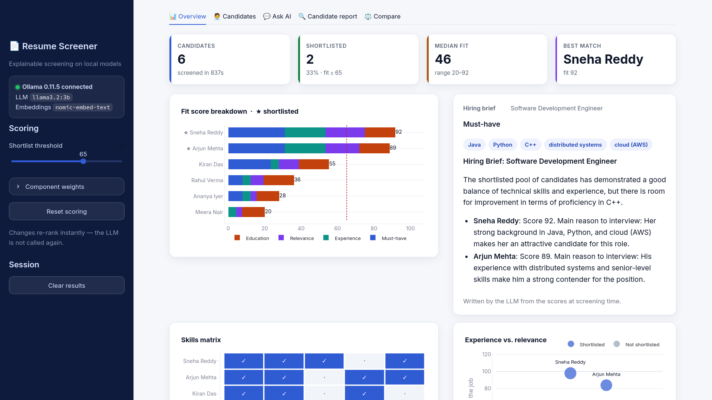
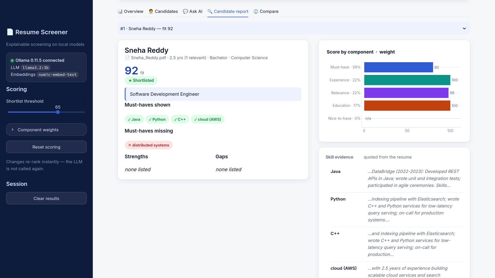
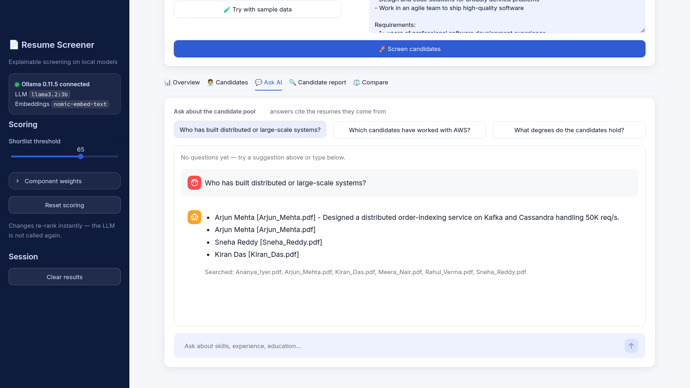
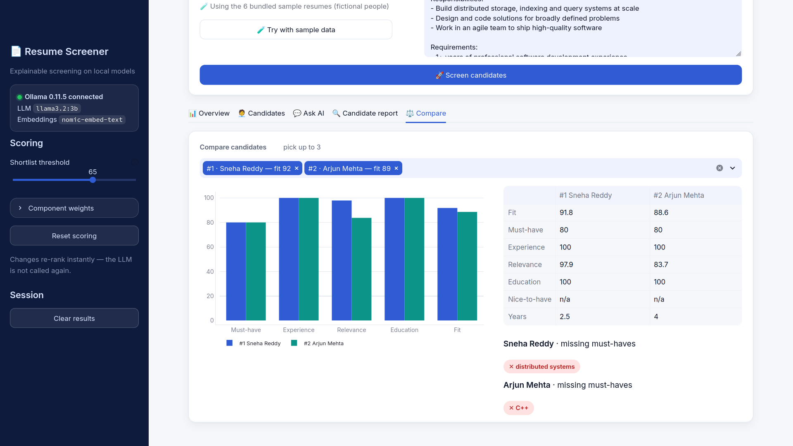
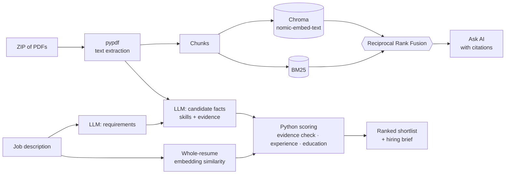

# Resume Screener


Screen a stack of resumes against a job description with **explainable scores**, entirely on your own machine.
Upload a ZIP of PDF resumes, paste a job description, and get a ranked shortlist where every score can be traced back
to evidence quoted from the resume — plus a chat assistant that answers questions about the candidate pool.

No API keys, no per-call cost, and no resume data leaves your computer: the LLM and embeddings run on [Ollama](https://ollama.com).



## Why it works this way

Small local models are good at **reading** but unreliable at **scoring**: asked for a number, a 3B model will happily
match three of three required skills and then report a score of 3/100. So this app splits the job:

1. **The LLM extracts facts** — the job's must-have / nice-to-have skills, minimum experience and degree; and for each
   resume the candidate's skills (each with a quoted piece of evidence), years of experience and education.
2. **Python computes every score** from those facts, deterministically. A skill only counts if it is written in the
   resume or the LLM's quoted evidence really appears in the resume — hallucinated skills are dropped.
3. **Embeddings add a relevance signal**, and a hybrid vector + keyword index powers grounded Q&A.

The result is a ranking you can explain line by line, and re-weight instantly without calling the model again.

## Features

- **Evidence-backed skill matching** – whole-word matching (`Java` ≠ `JavaScript`, `C++` ≠ `C`), plus LLM-inferred skills
  (e.g. *EC2 → AWS*) that are kept only when their quoted evidence is found in the resume.
- **Transparent fit score** – five components (must-have skills, experience, relevance, education, nice-to-have skills)
  shown as a stacked breakdown for every candidate.
- **Live re-ranking** – tune component weights and the shortlist threshold in the sidebar; results update instantly.
- **Hybrid retrieval for Q&A** – dense (Chroma) and BM25 keyword rankings merged with Reciprocal Rank Fusion, capped per
  resume so answers draw on the whole pool; answers cite the resume they come from.
- **Hiring brief** – a short written summary generated from the computed results, so it stays consistent with the scores.
- **Five views** – Overview (KPIs, score breakdown, skills matrix, experience-vs-relevance), Candidates (keyword search
  across all resume text, filters, CSV export), Ask AI, Candidate report (evidence table, strengths and gaps) and Compare.
- **Safe uploads** – PDFs are read in memory (no archive paths touch the disk), with file-count and size limits;
  scanned PDFs without a text layer are detected and listed.
- **Responsive, accessible UI** – design tokens, card layout, works on desktop / tablet / phone, honours reduced motion,
  and never relies on colour alone.
- **Sample data** – one click loads six fictional resumes and a job description.

| Live re-ranking | Candidate report with evidence |
|---|---|
|  |  |
| **Ask AI** | **Compare** |
|  |  |

## How it works



### Fit score

| Component | Default weight | How it is computed |
|---|---|---|
| Must-have | 35% | Share of the job's required skills the resume demonstrates (verified as above) |
| Experience | 20% | `20 + 80 × min(relevant years / required years, 1)` — only years in similar roles count |
| Relevance | 20% | Cosine similarity of job description and whole resume, rescaled to 0–100 |
| Education | 15% | Degree level vs. requirement (meets = 100, one level below = 60), × 0.75 if the field differs |
| Nice-to-have | 10% | Share of "preferred" skills demonstrated |

If the LLM cannot profile a resume, it is still scored from its text (skills and relevance) and flagged in the UI.

## Getting started

**Prerequisites:** Python 3.10+ and [Ollama](https://ollama.com/download).

```bash
# 1. Pull the local models (~2.3 GB)
ollama pull llama3.2:3b
ollama pull nomic-embed-text

# 2. Install
git clone <your-repo-url> resume-screener
cd resume-screener
python -m venv .venv
source .venv/bin/activate          # Windows: .venv\Scripts\activate
pip install -r requirements.txt

# 3. (Optional) override defaults
cp .env.example .env

# 4. Run
streamlit run app.py
```

Open http://localhost:8501, click **Try with sample data**, then **Screen candidates**.

**Performance:** on a 4-core laptop CPU without a GPU, the six sample resumes take several minutes to screen and a chat
answer takes one to a few minutes. A GPU, a larger `MAX_WORKERS`, or a faster model makes this much quicker.

### Configuration

All settings are optional environment variables (see [.env.example](.env.example)):

| Variable | Default | Purpose |
|---|---|---|
| `OLLAMA_BASE_URL` | `http://localhost:11434` | Ollama server |
| `LLM_MODEL` | `llama3.2:3b` | Extraction / chat model; any Ollama model with JSON-schema output (e.g. `qwen2.5:7b` for higher accuracy) |
| `EMBEDDING_MODEL` | `nomic-embed-text` | Embedding model |
| `NUM_CTX` | `8192` | LLM context window |
| `MAX_WORKERS` | `2` | Resumes profiled in parallel |

If you change the embedding model, re-check `RELEVANCE_FLOOR` / `RELEVANCE_CEIL` in
[resume_screener/scoring.py](resume_screener/scoring.py), because similarity ranges differ between models.

## Project structure

```
app.py                       Streamlit UI: layout, state, tabs
resume_screener/
  config.py                  Settings (env-overridable), limits, default weights
  ingest.py                  In-memory ZIP unpacking and PDF text extraction
  retrieval.py               Chunking, Chroma + BM25 index, Reciprocal Rank Fusion search
  schemas.py                 What the LLM extracts (Pydantic)
  prompts.py                 Prompt templates
  scoring.py                 Fact extraction + deterministic scoring and ranking
  assistant.py               Grounded Q&A and the hiring brief
  llm.py                     Ollama clients and health check
  charts.py                  Plotly figures
  ui.py                      Design tokens (CSS) and HTML components
samples/                     Six fictional resumes + a sample job description
scripts/make_sample_resumes.py   Regenerates the sample PDFs
tests/                       pytest suite (no Ollama needed)
```

## Development

```bash
pip install -r requirements-dev.txt
pytest            # unit tests + Streamlit smoke tests; retrieval is tested with a fake embedder
ruff check .      # lint
ruff format .     # format
```

## Limitations

- Scanned / image-only PDFs have no text layer and are skipped; there is no OCR.
- A 3B model sometimes misses a skill or misjudges which years of experience count as relevant (it tends to be
  conservative, e.g. not counting full-stack work for a backend role). Evidence checks catch invented skills, but
  treat the output as decision support for a human reviewer, not an automated hiring decision.
- Skill matching is lexical plus LLM inference; unusual synonyms may be missed.
